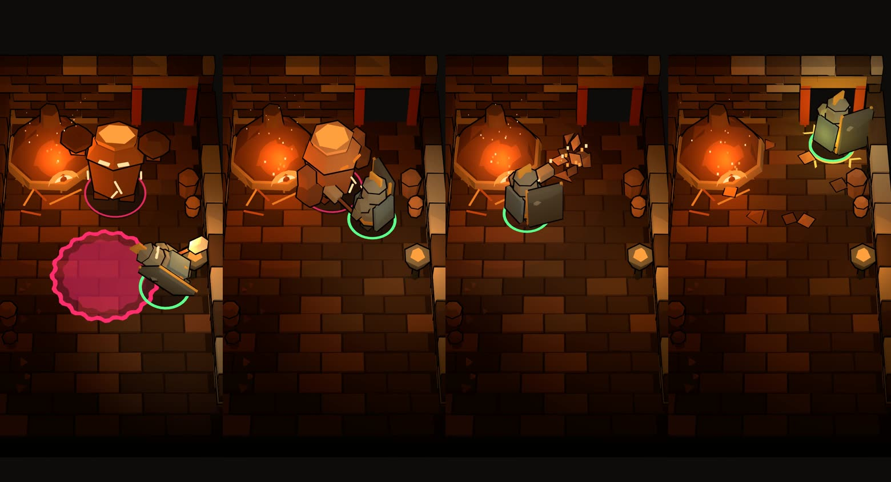
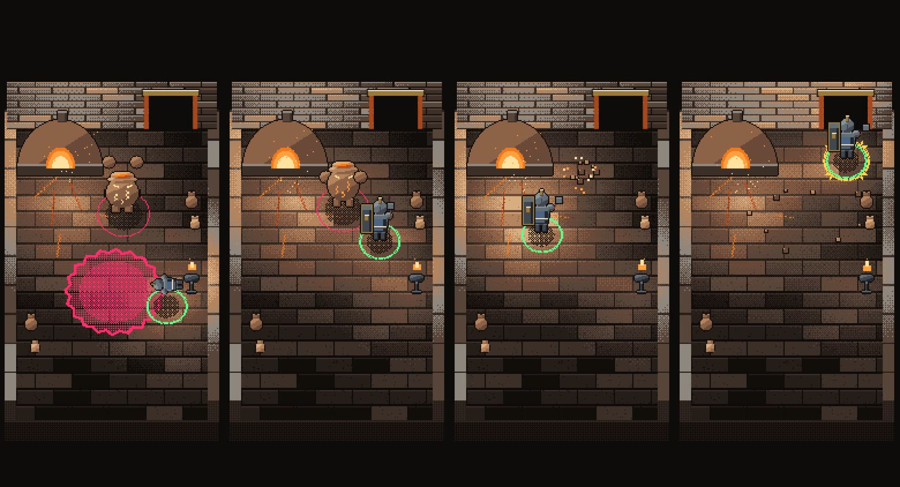
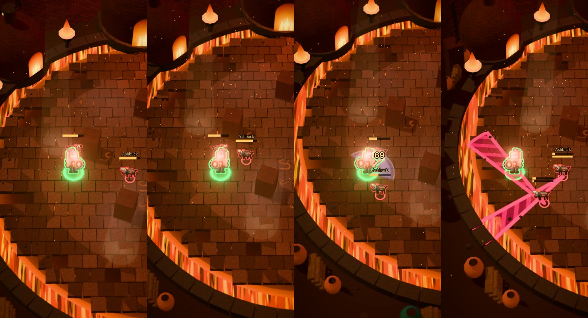

# Look test: one Kiln room, three looks, picked blind

1.0 vision v2, **Checkpoint 2**, visuals queue item 3. Pillars 4 (big in the hand) and 5 (one world, made by hand).
Steve said yes on 27 Nov (decision card): run the look test, and retire 2D if the new look wins.

The roadmap's test: "an animated 15-second clip of one hero against one foe in one Kiln room, judged blind by fresh
players against today's look and a pixel-art version" (`docs/design/roadmap.md`, vision v2). This folder makes all three clips.

| Clip | What it is | Made by |
|---|---|---|
| **Diorama** | The proposed look: a kiln-lit low-poly room floating in black, an iron Bulwark figurine, a clay foe that shatters | `client/looktest/diorama.ts` (three.js) |
| **Pixel** | The fallback: the same room and the same fight in pixel art at the new scale | `client/looktest/pixel.ts` (2D canvas, 195 x 422 art pixels) |
| **Today** | The live game's 3D view: a Bulwark against the first Kiln tier 1 pack, played by the game's own bot, DOM HUD hidden | `today.cjs` (the real build) |

The diorama and pixel clips play the **same scripted fight** from `client/looktest/timeline.ts`, frame for frame:
the foe sleeps, the hero walks up, the foe wakes and winds up a slam (danger zone), the hero rolls clear, hits it four
times (hit flash, squash, knockback), dodges a second slam, finishes it (hit-stop, shatter, ember burst, shards stay on
the floor), then the exit's stand-here ring lights and the hero walks into it. So a pick between them is a pick between
looks, not between choreographies. Today's clip can't follow a script, so it shows a real fight of the same length.

## Rules kept

- **Colours:** both new files start with `// style: palette-only`; `tests/style.test.ts` checks every hex against `client/style.ts`.
- **Signals:** danger is the jagged crawling zone, stand-here the ring with 4 chevrons pulsing in, ally the plain green ring.
  Steve's red-ring-under-foes rule is kept as a thin plain ring (no teeth, so it never reads as a zone).
- **Animation:** the six states from `style.ts` `ANIM` (idle bob, move lean and hop with land squash, wind-up pull-back and
  squash held for the whole tell, snap with overshoot, bone-white hit flash 60-80 ms with squash and knockback, die =
  shatter into 9 shards plus 12 embers). No rigs: rigid parts moved by code.
- **No generators, no image files:** every shape and pixel is code.
- **Light:** a dim fill plus 3 real lights (kiln, brazier, the hero's lantern); a 4th lights the stand-here ring after the kill.

## Measured (diorama, 390 x 844)

- Hero **72 px** feet to crest (target 70-80), foe 98 px (`window.lookTest.measure`, printed by `clips.cjs`).
- **Camera:** 55 degrees pitch and a 30 degree field of view as in `style.ts`, but it sits closer than `CAMERA.unitsAcross` = 9
  implies: about **5.7 units across**. `SIZE` says a 1.8-unit hero is 78 px at 9 units across, but that ignores the 55 degree
  pitch, which shortens an upright figure to about 57%. At 9 units across the same hero measured **49 px**. The figure kit
  (CP3) should fix one of the two numbers in `style.ts`; this test keeps the hero size and moves the camera.
- **Draw calls: 111** in the fight. The room is merged into one mesh per material; the rest is the figures (two draws per part,
  toon plus outline) and the loose particles (22 kiln embers, 12 burst embers, 8 dust, 9 shards). The game's bar is 96 at
  320 x 568, so the figure kit must instance particles and merge each figure's parts.

## Re-make the clips

```
npm ci && npm run build
node docs/art/look-test/clips.cjs <outDir>            # diorama.mp4 and pixel.mp4 (both), 30 fps; about 2 min each here
STILLS=1 T=4.2,10.5 node docs/art/look-test/clips.cjs <outDir> diorama   # stills at chosen times
node docs/art/look-test/today.cjs dist <outDir>        # today.mp4 from the real build (HUD=1 keeps the HUD)
```

Both scripts step time by hand (1/30 s a frame) and screenshot each frame, so the slow software GL in the cloud still
gives smooth 30 fps clips. `blind.cjs` then labels the three clips A, B, C in a random order and builds the side-by-side.

## Shots

Frames at 4.3 s (danger zone), 6.0 s (a hit), 10.4 s (the shatter) and 13.3 s (walking to the exit); today's clip at the same times.





## The blind pick

This repo names the clips openly. The set for testers lives in project files, `horders/visuals/look-test/blind/`
(`clip-A/B/C.mp4`, `side-by-side.mp4`, `frames-A/B/C.jpg`), where the letters don't say which is which; the key is kept
apart in `horders/visuals/look-test/KEY.md`. The test passes when cold testers (people who have never seen the game)
pick the diorama over both others (roadmap Checkpoint 2). An AI playtester panel read from the still frames would be a
cheap first signal, but it can't replace fresh human eyes on the moving clips.
