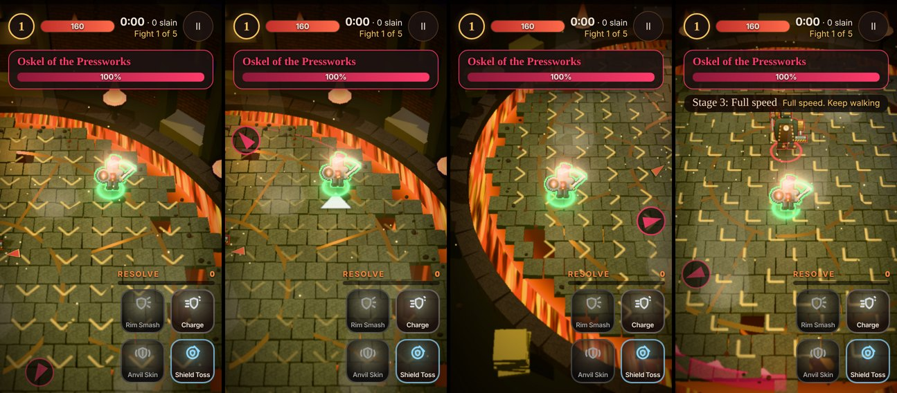
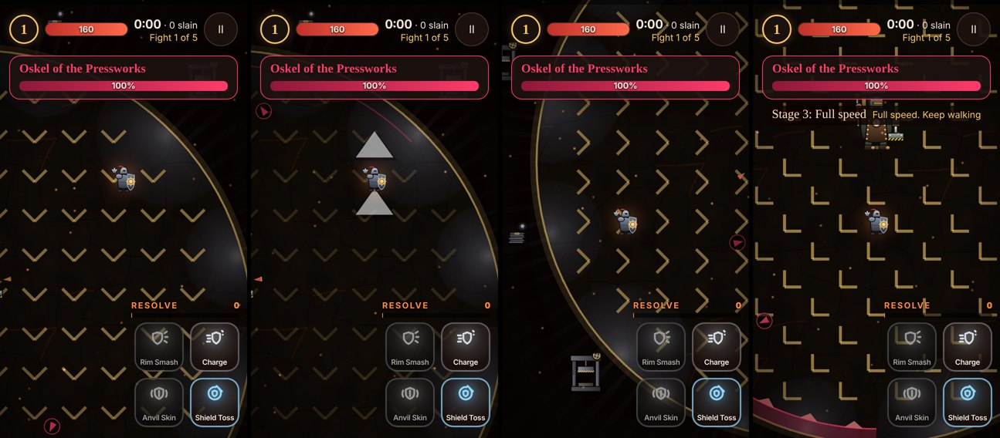

# Oskel v2: phone fixes from QA (25 Nov)

QA's phone check of the staged Oskel (#783) found these, at 320x568 in 2D (shots in /mnt/project-files/horders/qa/oskel-v2/):

1. **The flip arrows were off screen.** They were drawn within 220 of the arena's centre, but the party fights near
   Oskel and the rim. Now two big white arrows, pointing the new way, sit just in front of and behind every living
   hero, with a dark edge so they read on the pale 3D press bed. They pulse but never drop below 0.6, so a still frame
   always catches them.
2. **A red edge arrow to the crush line.** While the crush line is off screen, a red arrow at the edge of the view
   points at it. During a flip warning it points at the next one. It reuses the gold edge arrow (emptyVents) with a
   colour, in 2D and 3D.
3. **Bolder chevrons.** They are 24 long (was 18) and 6 wide (was 4), at 0.5 alpha (was 0.32), or 0.6 at full speed.
4. **Stage lines.** "Stage 2: The belt" and "Stage 3: Full speed" are now the slim warning line (hud.warn), like
   Ondrel's stage 3 (#750), so the floor stays clear. The Downstroke line already was one.

Cost is unchanged: everything is on the floor graphics or the overlay.

Shots: Pressworks t10, seed 3, Bulwark, frozen. From the left:
- stage 2 with the hero 424 from the centre;
- a flip warning there;
- the crush line off screen to the east (red edge arrow);
- stage 3 running diagonally, with its warning line.

3D:

2D:

`node shots.cjs <dist> <outdir>` (env NO3D=1 for 2D).

A separate finding: with the camera near the north-east rim, the Oskel arena costs 112-114 draw calls in every
stage, including stage 1 before this change. That is over the 96 bar, and it is followed up on its own.
