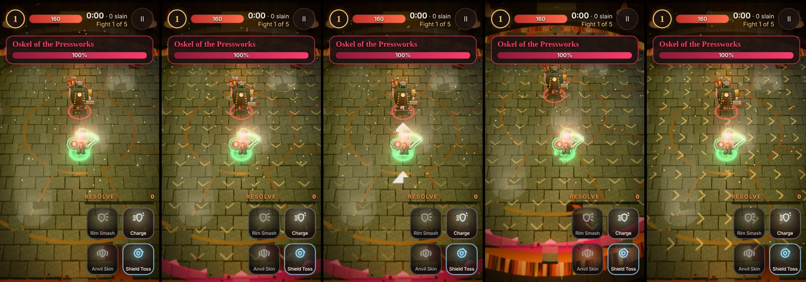
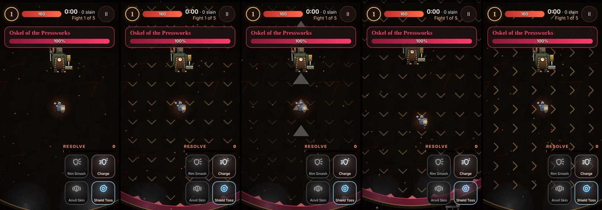

# Oskel v2: the running press bed (visuals, 25 Nov)

This is the art for design's staged Oskel (oskel-v2.md, sim in #777, behind `?oskelv2=1`). It is drawn on the floor
graphics, so 3D shows it through the floor bridge at 0 extra draw calls (71 in every shot, the same as stage 1).
The code is `oskelBelt` in client/GameScene.ts. It reads `osStage`, `osDir` and `osFlipT`, which already reach co-op guests.

- **Belt streaks (stage 2 and 3):** rows of gold chevrons over the whole floor slide the way the bed carries, at its
  speed (`belt`, then `belt3`). They are brighter at full speed and dim during a flip warning, so the arrows stand out.
- **Flip warning (the 1.5 s before each flip):** five big white arrows blink through the middle of the floor, pointing the
  new way. The next crush line is outlined on the opposite rim.
- **Crush line:** a red band on the downstream 90 degrees of the rim, 30 deep, in the enemy-attack colour, with press
  teeth along its inner edge. It pulses slowly.
- The crush itself is the sim's `slam` event, which already shakes the screen and plays sound #779.

Shots: Pressworks t10, seed 3, Bulwark, 320x568, frozen. From the left: stage 1 (nothing drawn), stage 2 belt running
toward the camera, flip warning, hero near the crush line (the near rim), stage 3 running east.

3D:

2D:

`node shots.cjs <dist> <outdir>` (env NO3D=1 for 2D, LAND=1 for landscape).
