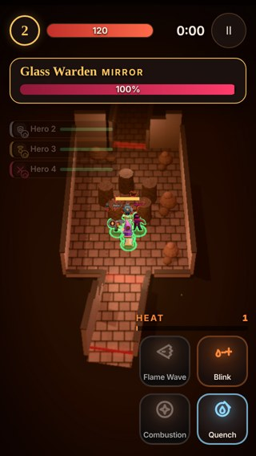
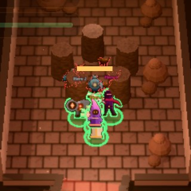
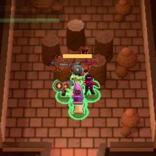

# Fewer draws for a four-hero party (raid trash cost check, 25 Nov)

Design asked for the busiest raid room to be measured with four heroes and raid trash on (`?raidtrash=1`, #787)
before raid trash ships, and for a saving if it was over the 96 bar.

**Measured** on the Crucible's Halls map, tier 8, at 320x568. Emberwright plus Bulwark, Lumen and Duskblade bots,
all standing in the room. Each pack was woken and fought for 4 s, then frozen. Seeds 1-6, raid trash on. The busiest
room was seed 4's B pack (Glass Wardens) at **106**, and seed 5's A pack was 99.

**Where the draws went** (a per-object count, not committed):
- Each hero cost 7 draws: its sprite, the sprite's shadow, the green outline, the green ring, the faint disc, the
  blob shadow and the name. Three more heroes cost +21.
- Every standing stone was its own mesh plus its shadow. Seed 4's B room had 8 stones in view, which cost 13 draws.

**The change** (client/hd2d/renderer.ts). Nothing about how anything looks changed.
- The party's green rings, discs and blob shadows are three instanced meshes for the whole party, not three meshes
  per hero: -9 with four heroes, -3 solo.
- The room's stones and pillars are one instanced mesh each (a draw plus a shadow draw each), not a mesh apiece.
  A room with no stones in view now pays those 2-4 draws, but no room pays more than that.

Busiest room per seed, raid trash on, before / after:

| Seed | 1 | 2 | 3 | 4 | 5 | 6 |
|---|---|---|---|---|---|---|
| Before | 91 | 91 | 91 | 106 | 99 | 87 |
| After | 82 | 82 | 80 | 86 | 86 | 79 |

The worst is now 86, 10 under the bar. For comparison, raid trash off (seeds 1-3, before) was 84 at most.

Seed 4's B room, before / after (the same frame; stones, rings and shadows look the same):
 
Close up:  

`SEEDS=4 node shots.cjs <dist> <out>` (one seed per run; RT=0 for trash off).
