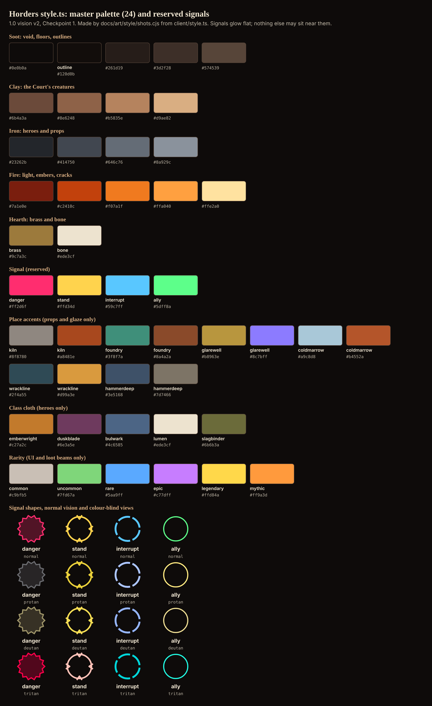

# Style: palette, signals, sizes, reference board and animation spec

1.0 vision v2, **Checkpoint 1** (visuals queue items 1 and 2). Pillars 2 (read it, answer it) and 5 (one world, made by hand).
Plan of record: `docs/design/roadmap.md` "1.0: the road to launch (vision v2)" and `docs/design/vision/vision.md` section 7.

Nothing here changes the game yet. `client/style.ts` is the source that new art (the figure kit, the Kiln room diorama and the look test) builds from. The old art (`client/textures.ts`, `client/hd2d/renderer.ts`) stays as it is until it is replaced.

`node docs/art/style/shots.cjs` re-makes `palette.png` from `client/style.ts`.

## 1. The palette (`client/style.ts`)

| Group | Count | Use |
|---|---|---|
| `MASTER.soot` | 5 | void, floors, outlines (`#120d0b`, never pure black) |
| `MASTER.clay` | 4 | the Court's creatures |
| `MASTER.iron` | 4 | heroes, props |
| `MASTER.fire` | 5 | light, embers, glowing cracks |
| `MASTER.hearth` | 2 | brass fittings and bone-white highlights (Wick's materials: iron, cloth and brass) |
| `MASTER.signal` | 4 | **reserved**: Danger, Stand here, Interrupt, Ally. Drawn unlit, nothing else |
| `ACCENTS` | 2 per place | props and glaze only, never a full-screen wash |
| `CLOTH` | 1 per class | heroes only |
| `RARITY_COLOR` | 6 | UI and loot beams only; equal to `sim/content/items.ts` RARITY (tested) |

Vision.md lists 22 master colours (soot 5, clay 4, iron 4, fire 5, signal 4) and says 24. The two added are **brass and bone**, because the material rule names brass as one of the town's three materials and bone covers highlights, the Lumen's ivory cloth and the 60-80 ms hit flash.

**Changes from vision.md, found by the test (CIE76 dE, the same measure `tests/season.test.ts` uses):**
- Fire `#ffb347` sat **18.8** from Stand-here gold. It is now `#ffa040` (29.4).
- Glarewell brass `#c9a227` sat **18.6** from Stand-here gold. It is now `#b8963e` (29.7).
- The Hammerdeep had no accents in vision.md. Proposed: blued steel `#3e5168` and whetstone `#7d7466`.
- Vision.md calls Danger `#ff2d6f` "the current pink-red". The game today draws foes in `#ff3b3b` (`client/hd2d/renderer.ts:1171`, `BAD`), 31.1 dE away. `#ff2d6f` is the new value; the old renderer is not changed here.

## 2. Signals: one colour and one shape each

| Signal | Colour | Shape (`SIGNAL_SHAPE`) |
|---|---|---|
| Danger: move | `#ff2d6f` | filled zone, serrated edge whose teeth crawl (2.5 teeth per unit, 0.6 units/s) |
| Stand here | `#ffd34d` | solid ring, 4 chevrons pointing in, pulsing inward every 0.9 s |
| Interrupt | `#59c7ff` | ring broken into 5 segments; the gaps widen from 6 to 22 degrees as the cast ends |
| Ally | `#5dff8a` | plain ring and thin outline |

Every telegraph warns for at least `MIN_WARNING_SEC` = 0.8 s.

**What the test checks (`tests/style.test.ts`, 17 tests):** exactly 24 distinct master colours; each ramp runs dark to light; accents and cloths are told apart; signals at least 40 dE from each other; **no other in-world colour within 25 dE of a signal**; Danger at least 30 dE from every fire colour; every signal pair at least 15 dE apart in protan, deutan and tritan views (Machado 2009); size and animation sanity; and any file whose first line is `// style: palette-only` may hold no six-digit hex colour outside `style.ts`. New figure kit and room files should start with that line.

**Colour-blind result (measured):** the closest pairs are tritan Interrupt/Ally (19.9) and protan Stand/Ally (21.4). In the bottom rows of `palette.png` those pairs look alike in hue, so the shapes carry them. A signal must never be drawn without its shape.

## 3. Size targets (390x844 portrait)

Camera fixed at about 55 degrees pitch with a 30-degree field of view, about 9 world units across (43.3 px per unit).

| Thing | Target | In `style.ts` |
|---|---|---|
| Hero | 70-80 px (1.8 units = 78 px) | `SIZE.heroUnits`, `SIZE.heroPx` |
| Trash foe | at least 40 px | `SIZE.trashMinPx` |
| Elite | 60-90 px | `SIZE.elitePx` |
| Boss | at least a third of the screen width, 3-5x hero height | `SIZE.bossMinScreenFrac`, `SIZE.bossHeroScale` |
| Room | about 9 x 14 units, portrait, front wall cut away | `SIZE.roomUnits` |

Light budget: a dim fill, one warm light per hero (radius 4), at most 4 real lights per room, a 3-step toon ramp (`LIGHT`).

## 4. Reference board: the quality target

Eight shipped games whose look is simple shapes, few colours and strong lighting or motion. We study them for **how they read and move**, never to copy their characters, names, levels or art. Links are their store pages.

| Game | Link | What we take from it |
|---|---|---|
| Thronefall | [Steam](https://store.steampowered.com/app/2239150/Thronefall/) | A tiny palette and simple models with outlines, made by a two-person team ([Game Developer](https://gamedeveloper.com/design/mastering-minimalism-and-layering-complexity-with-strategy-game-thronefall)). The proof that our approach can look finished. |
| Dungeon of the Endless | [Steam](https://store.steampowered.com/app/249050/Dungeon_of_the_ENDLESS/) | Rooms as small lit pieces floating in darkness: the closest match to "kiln-lit dioramas". |
| Bad North | [Steam](https://store.steampowered.com/app/688420/) | Tiny low-poly figures that still read at a distance, and deaths that are quick and clear. |
| Death's Door | [Steam](https://store.steampowered.com/app/894020/Deaths_Door/) | Top-down 3D combat: wind-ups you can read, snappy strikes, hit flashes, a muted world with bright threats. Our main **animation** target. |
| Going Under | [Steam](https://store.steampowered.com/app/1154810/) | Flat-shaded low-poly roguelike rooms; a strong, consistent colour identity on simple shapes. |
| TUNIC | [Steam](https://store.steampowered.com/app/553420/TUNIC/) | A fixed high camera on small rooms, a hero with one clear silhouette, toon lighting. |
| Minishoot' Adventures | [Steam](https://store.steampowered.com/app/1634860/) | Clean simple 3D with bright readable projectiles against a calm world. |
| Monument Valley | [App Store](https://apps.apple.com/app/id728293409) | A phone-first diorama look: the bar for "looks crafted" on an iPhone screen. |

Rule for reviews: put our clip or shot next to one of these at the same size on a phone. If ours looks rougher in silhouette, light or motion, it isn't done.

## 5. Animation spec (no rigs: rigid parts plus code tweens)

The red team's warning: stiff code-built figures are what players notice first. Every body gets these six states. Numbers live in `style.ts` `ANIM` and are **starting values** to tune in the Checkpoint 2 look test, by watching recorded clips, not still frames.

| State | Hero (iron figurine) | Foe (clay pottery) | Numbers |
|---|---|---|---|
| **Idle** | gentle bob and breathe | same, plus crack glow pulse | 1.6 s period, bob 3% of height, scale 3%, random phase per body so packs don't bob in step |
| **Move** | leans into the stick, small hop per step | leans forward harder, scuttles | lean 8-12 degrees, 4 steps/s, hop 5% of height, land squash 1.08 x 0.92 |
| **Wind-up** | weapon part pulls back | body pulls back and squashes, eyes brighten | pull back 15 degrees, squash 1.1 x 0.9, ease-out; trash at least 0.35 s; telegraphed attacks hold for the whole tell (at least 0.8 s) |
| **Attack** | snap forward with overshoot | lunge or slam with overshoot | snap 60-90 ms, overshoot 10 degrees, settle 150 ms, ease-out-back |
| **Hit** | bone-white flash, small squash | flash, squash, knockback | flash 60-80 ms in bone `#ede3cf` (never a signal colour), squash 1.12 x 0.9, knockback 0.25 units on normal foes, recover 120 ms |
| **Die** | topples and dims (iron doesn't break) | **shatters** into 6-10 clay shards plus an ember burst; shards stay on the floor for the rest of the room | topple 0.45 s, dim to 40%; 12 embers |

How the figure kit builds this: each figure is a small tree of parts (body, head, weapon or shield, feature such as hood, halo, cowl or cannon). A state is a tween on part rotations, positions and a whole-body scale, blended over about 80 ms when the state changes. A shard is a pre-cut piece of the foe's body mesh, thrown with a random spin and left in place.

## 6. What comes next (visuals queue)

- Item 3, the look test (one Kiln room, one hero, one foe, animated 15 s clip, plus a pixel-art version), waits for Steve's yes on decision 1.
- Every new art PR imports colours from `client/style.ts`, starts its files with `// style: palette-only`, and names its pillar.
