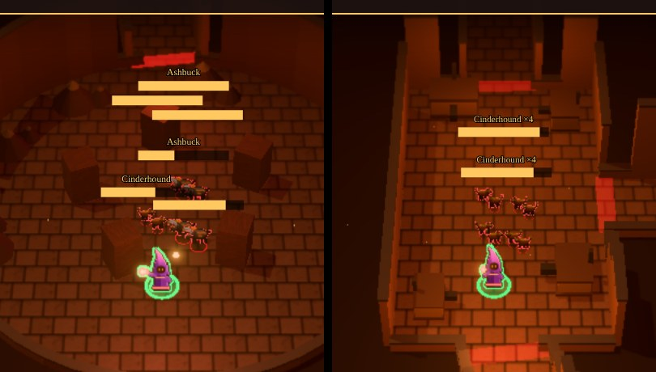
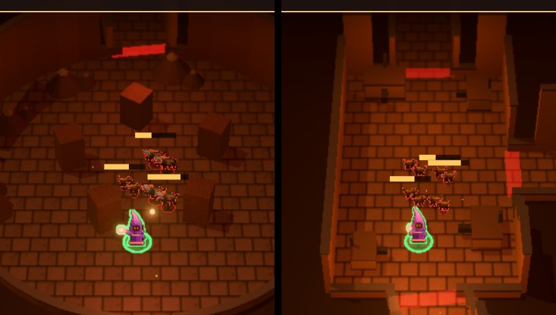

# Trash bars: small, on the foe, once hit (visuals, 25 Nov)

Design asked for this in the Kiln retune (kiln-trash-plan.md): doubled opener packs. With 6 to 8 foes bunched
together, the bar overlap rule stacked their full-size bars and names into a column about 100 px above the clump,
far from the foes the bars belonged to.

Rule (client/GameScene.ts, `trashFoe`): an unnamed foe of a Halls opener pack (map roles A and B) is trash.
- No bar until it has been hit. Then it gets a small 30 px by 4 px bar right on its head.
- Trash bars never stack or lift, and trash has no name over its head. The target frame still names it.
- A trash foe mid-cast keeps the full bar, so an interrupt target is always marked.
- Elites in other packs, named foes and bosses keep today's bars and the stacking rule.

Cost: 91 draw calls before and after (the overlay is 0 draws). 2D gets the same small bar.

Shots: Kiln Halls tier 2, seed 3, Emberwright, 320x568, opener packs doubled, every other foe set to 30-80% health.
Left: Ashbucks with Cinderhounds. Right: the Cinderhound pack.

Before:

After:

`node shots.cjs <dist> <outdir>`, with env SEEDS=3. It saves live-<pack>.png about 5 s into each pack's fight.
